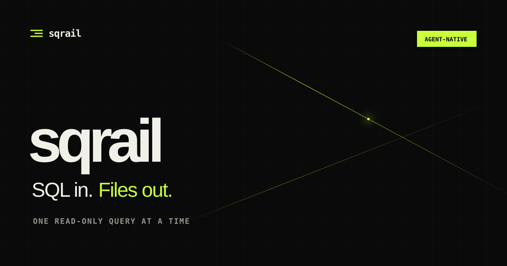

<div align="center">
  <a href="https://sqrail.yhay81.com">
    
  </a>

  <p>
    <strong>Run one read-only SQL query over local CSV, TSV, JSON, and Parquet files.</strong><br>
    A small, predictable CLI for coding agents that already write SQL.
  </p>

  <p>
    <a href="https://github.com/yhay81/sqrail/actions/workflows/ci.yml"></a>
    <a href="https://github.com/yhay81/sqrail/releases/latest"></a>
    <a href="https://github.com/yhay81/sqrail/blob/main/LICENSE"></a>
    <a href="https://github.com/yhay81/sqrail"></a>
  </p>

  <p>
    <a href="https://sqrail.yhay81.com">Website</a>
    ·
    <a href="https://sqrail.yhay81.com/docs/">3-minute guide</a>
    ·
    <a href="docs/CONTRACT.md">Contract</a>
    ·
    <a href="docs/RECIPES.md">Recipes</a>
    ·
    <a href="docs/BENCHMARKS.md">Benchmarks</a>
    ·
    <a href="SECURITY.md">Security</a>
  </p>
</div>

---

## What is sqrail?

sqrail is a single command that treats local data files as SQL tables. You give
each file a table name, write one ordinary SQL query, and get the result back as
JSON Lines on stdout or as a new CSV, JSON, or Parquet file.

It is built for coding agents. Models already write good SQL, so sqrail does not
translate natural language or add a query language of its own. Instead it gives
that SQL a narrow, predictable place to run:

- **Only the files you name can be read.** Nothing else on disk is reachable.
- **Nothing can be changed.** One `SELECT`, `VALUES`, or `WITH` query is
  accepted, inputs are never modified, and existing files are never
  overwritten.
- **Every run stays within the limits you set** for memory, threads, time,
  rows, bytes, files, and SQL size.
- **Every result is machine-readable.** Rows go to stdout; a failure is one
  JSON object on stderr with a stable exit code.

The query engine is [DuckDB](https://duckdb.org), embedded in the binary. sqrail
is the boundary around it, and the whole interface fits in a
[195-word `--help`](https://sqrail.yhay81.com/help.txt).

## Quick look

Bind each file to a table name with `-t NAME=PATH`, then pass the SQL. Here `-`
reads it from stdin so it needs no shell quoting:

```sh
sqrail run -t sales=sales.csv -t drugs=drugs.parquet - <<'SQL'
SELECT d.name, sum(s.amount) AS total
FROM sales AS s
JOIN drugs AS d USING (drug_id)
GROUP BY d.name
ORDER BY total DESC
SQL
```

Each result row is one JSON object on stdout:

```text
{"name":"Alphazol","total":25}
{"name":"Betamab","total":20}
```

Add `-o` to write a file instead. The extension selects the format, and the file
appears only after the query succeeds:

```sh
sqrail run -t sales=sales.csv -o totals.parquet \
  'SELECT drug_id, sum(amount) AS total FROM sales GROUP BY drug_id'
```

When a query is refused or fails, stdout stays clean, stderr carries exactly one
JSON object, and the exit code says which stage failed:

```console
$ sqrail run -t sales=sales.csv 'DELETE FROM sales'; echo "exit $?"
{"schema_version":1,"sqrail_version":"0.3.4","ok":false,"code":"READ_ONLY_QUERY","message":"only a SELECT, VALUES, or WITH query is allowed"}
exit 4
```

The [recipes](docs/RECIPES.md) cover conversion, joins, partitioned Parquet, and
JSONL validation with commands you can paste into an empty directory.

## How it works

```text
-t sales=sales.csv      --+
-t drugs=drugs.parquet  --+--> one read-only SQL query --> rows as JSONL on stdout
-t events=events/       --+    run by DuckDB within         or one file with -o
                               your limits
                                    |
                                    +--> on failure: one JSON object on stderr
                                         and a stable exit code
```

Three commands cover the whole workflow:

| Command                     | Use it to                           | Prints                                                 |
| --------------------------- | ----------------------------------- | ------------------------------------------------------ |
| `sqrail schema FILE...`     | learn column names and types        | one JSON object per path with its files and columns    |
| `sqrail check [-t ...] SQL` | validate a query without running it | result columns, bound inputs, and the physical plan    |
| `sqrail run [-t ...] SQL`   | execute the query once              | JSONL rows, or nothing when `-o` writes a file instead |

A typical agent turn is short: run `schema` once if the names and types are
unknown, otherwise trust them; `run` once; stop when the exit code is `0`.

## Why not call DuckDB directly?

You can. sqrail runs the same engine and does not claim to be faster than it.
The difference is what one invocation is allowed to do. A database shell is
designed to do anything you ask. sqrail is designed so that a command can do only
one bounded thing, which is what you want when a model chooses the SQL and a
program reads the result.

| Question                    | sqrail's answer                                                                                                                              |
| --------------------------- | -------------------------------------------------------------------------------------------------------------------------------------------- |
| What can the query read?    | Only paths bound with `-t`. DuckDB external access and extension loading are disabled, and the configuration is locked.                      |
| What can it change?         | Nothing. Inputs are exposed as read-only views; writes, `COPY`, `ATTACH`, `INSTALL`, `LOAD`, `PRAGMA`, and multiple statements are rejected. |
| How much can it use?        | Only what you allow with the [resource limits](#resource-limits). Going over a limit is an error, never a silently truncated result.         |
| What if it fails halfway?   | With `-o`, output is written privately and committed atomically. A failed run leaves no file, and an existing file is never replaced.        |
| What does the caller parse? | stdout carries only rows. Each failure is one versioned JSON object on stderr with a [documented exit code](#errors-and-exit-codes).         |
| Is there any hidden state?  | No configuration file, network service, embedded model, daemon, or telemetry. The same command behaves the same way every time.              |
| How does an agent learn it? | From `sqrail --help`, which is complete in 195 words, instead of a long tool manual in every prompt.                                         |

sqrail is **not** a natural-language-to-SQL tool, an interactive shell, a
persistent database, or an operating-system sandbox. The
[concept](docs/CONCEPT.md) ([日本語](docs/CONCEPT.ja.md)) explains the design
constraints and non-goals.

## Install

On macOS or Linux with Homebrew:

```sh
brew install yhay81/tap/sqrail
```

Or download a prebuilt archive for Linux, macOS, or Windows on x86-64 or Arm64
from [Releases](https://github.com/yhay81/sqrail/releases/latest), extract it,
and put `bin/sqrail` on `PATH`. It is one executable: no language runtime,
package manager, daemon, or database server is required.

- Linux archives need glibc 2.35 or newer and statically include the C++
  runtime.
- Windows archives statically include the MSVC runtime and need a
  UTF-8-capable Windows 10/11 or Windows Server release.
- Each release publishes `SHA256SUMS`, an SPDX SBOM, and GitHub build-provenance
  and SBOM attestations.
  [Verify a release archive](docs/PLATFORMS.md#verify-a-release-archive) gives
  the commands for macOS, Linux, and PowerShell.

Then confirm it runs:

```sh
sqrail --version
sqrail --help
```

On macOS and Linux, `man sqrail` shows the same reference.
[Platform support](docs/PLATFORMS.md) lists the tested platform tiers.

## Use it from a coding agent

sqrail needs no SDK: an agent calls it like any other shell command. The
smallest useful instruction is:

```text
Run `sqrail --help`.
If names and types are unknown, use `sqrail schema` once.
Otherwise trust the stated schema, run once, and stop after success.
```

The same decision rule and stop condition are built into `--help`. The
low-cost-model experiments behind them are in the
[agent experiment log](benchmarks/agent-eval/EXPERIMENTS.md).

The optional [Agent Skill](skills/sqrail/SKILL.md) tells compatible agents when
to reach for sqrail without adding the manual to every prompt. With GitHub CLI
2.90 or newer:

```sh
gh skill preview yhay81/sqrail sqrail
gh skill install yhay81/sqrail sqrail --agent codex --scope user
```

Replace `codex` with your host, such as `claude-code`, `cursor`,
`github-copilot`, `opencode`, `cline`, `kiro-cli`, or `windsurf`. Google's
AGY/Antigravity CLI uses the repository's native plugin instead:

```sh
agy plugin install https://github.com/yhay81/sqrail
```

To have an agent install both the executable and the Skill, give it the
review-first [AI installer](https://sqrail.yhay81.com/install-agent.md). It falls
back to `npx skills` when GitHub CLI is unavailable.
[Agent integration](docs/AGENT_INTEGRATION.md) collects further patterns.

## Reference

`sqrail --help` is the complete short interface. The
[CLI contract](docs/CONTRACT.md) is normative for every detail, including the
JSON schemas and failure semantics.

```text
sqrail schema [--memory SIZE] [--threads N] [--timeout DURATION]
              [--max-input-files N] [--strict-schema] FILE...
sqrail check [-t NAME=PATH]... [--memory SIZE] [--threads N]
             [--timeout DURATION] [--max-rows N] [--max-input-files N]
             [--max-sql-bytes SIZE] [--strict-schema] [SQL|-]
sqrail run [-t NAME=PATH]... [-o FILE] [--memory SIZE] [--threads N]
           [--spill DIR [--max-spill SIZE]] [--timeout DURATION]
           [--max-rows N] [--max-output-bytes SIZE] [--max-input-files N]
           [--max-sql-bytes SIZE] [--stats] [--strict-schema] [SQL|-]
```

### Inputs and queries

- `-t NAME=PATH` binds a table name to one file, a glob, or a partitioned
  Parquet directory, whose `key=value` directory names such as `year=2026`
  become columns. Repeat it for each table.
- The files in one binding are combined by column name, and a column missing
  from some files is `null`. `--strict-schema` instead requires identical
  names, order, and types.
- The SQL is one `SELECT`, `VALUES`, or `WITH` query in the DuckDB dialect that
  `sqrail --version` reports. Pass it as an argument, or as `-` to read it from
  stdin.
- Row order is undefined unless the query contains `ORDER BY`.

Every format can be read and written:

| Format     | Extensions          | Notes                                            |
| ---------- | ------------------- | ------------------------------------------------ |
| CSV        | `.csv`              |                                                  |
| TSV        | `.tsv`, `.tab`      |                                                  |
| JSON       | `.json`             | written as one JSON array                        |
| JSON Lines | `.jsonl`, `.ndjson` | written as one object per line                   |
| Parquet    | `.parquet`          | also read from a glob or a partitioned directory |

Text formats may also end in `.gz` or `.zst`. Externally compressed Parquet and
bzip2/xz streams are deliberately rejected.

### Outputs

- **Without `-o`**, each row is one JSON object on stdout and nothing else is
  written there. Rows stream as they are produced, so a query that fails midway
  may already have printed a valid prefix. Use `-o` when the consumer needs
  all-or-nothing output.
- **With `-o FILE`**, the extension selects the format and a successful run is
  silent. The file is written under a private temporary name with owner-only
  permissions and committed atomically after success. An existing file is
  never replaced; the run fails with `OUTPUT_EXISTS` instead.
- **`--stats`** makes a successful `run` add one JSON object on stderr:

```json
{
  "schema_version": 1,
  "sqrail_version": "0.3.4",
  "ok": true,
  "command": "run",
  "rows": 2,
  "bytes": 342,
  "elapsed_ms": 127,
  "input_files": 1,
  "destination": "file"
}
```

### Resource limits

Every limit is stated on the command line, and exceeding one fails with a
structured diagnostic instead of degrading silently:

```sh
sqrail run \
  --memory 1GB \
  --threads 2 \
  --spill /fast-nvme/sqrail-spill \
  --max-spill 100GB \
  --timeout 10m \
  --max-rows 1000000 \
  --max-output-bytes 4GiB \
  --max-input-files 10000 \
  --max-sql-bytes 1MiB \
  --stats \
  -t data='warehouse/**/*.parquet' \
  -o result.parquet \
  - < query.sql
```

| Option                            | What it bounds                                                                           |
| --------------------------------- | ---------------------------------------------------------------------------------------- |
| `--memory SIZE`                   | DuckDB's memory limit. It is not a hard operating-system RSS limit.                      |
| `--threads N`                     | Worker threads.                                                                          |
| `--timeout DURATION`              | The whole command, from input discovery and schema inference to output commit.           |
| `--spill DIR`, `--max-spill SIZE` | Temporary disk. Without `--spill`, nothing spills to disk.                               |
| `--max-rows N`                    | Rows in the final result. A larger result fails with `RESULT_LIMIT` and commits no file. |
| `--max-output-bytes SIZE`         | Bytes written to stdout or the output file.                                              |
| `--max-input-files N`             | Files matched across every glob and directory, checked before they are read.             |
| `--max-sql-bytes SIZE`            | Size of the SQL text, checked before parsing.                                            |

`--spill` creates a unique, owner-only workspace beneath `DIR` for each process
and removes it afterwards; other files under `DIR` are never visible to SQL.
sqrail also disables insertion-order preservation so that unordered file
transformations can use less memory.

### Errors and exit codes

Every handled failure writes exactly one JSON object with `schema_version`,
`sqrail_version`, `ok: false`, a stable `code`, and a human-readable `message`.
The exit code identifies the failing stage:

| Exit | Stage                         | Example codes                                                      |
| ---: | ----------------------------- | ------------------------------------------------------------------ |
|    0 | success                       |                                                                    |
|    2 | command usage                 | `UNKNOWN_OPTION`, `MISSING_VALUE`, `SQL_LIMIT`                     |
|    3 | input file or format          | `INPUT_NOT_FOUND`, `INPUT_LIMIT`, `SCHEMA_MISMATCH`                |
|    4 | SQL parse, bind, or execution | `READ_ONLY_QUERY`, `QUERY_FAILED`, `QUERY_TIMEOUT`, `RESULT_LIMIT` |
|    5 | output path or commit         | `OUTPUT_EXISTS`, `OUTPUT_LIMIT`, `STDOUT_WRITE`                    |
|   70 | unexpected internal failure   | `INTERNAL`                                                         |

## Safety boundary

The restrictions above are enforced inside the process. sqrail rejects write
statements, disables DuckDB external access and extension loading, locks the
configuration, and allowlists only the bound inputs, the private output
temporary path, and the private spill workspace. SQL therefore cannot read
arbitrary local paths, including other files under the spill root.

This is defense in depth, not an operating-system sandbox. Run hostile SQL or
malformed data inside an OS sandbox as well, and report suspected
vulnerabilities through the [security policy](SECURITY.md).

## Performance

The goal is DuckDB-class execution behind a smaller, deterministic interface,
not to outrun the engine sqrail embeds. The committed harness builds sqrail and
the DuckDB CLI from the same source revision, checks that their outputs match,
and records time and peak RSS. See the [benchmark policy](docs/BENCHMARKS.md),
the [harness](benchmarks/README.md), and the
[measured baseline](docs/BASELINE.md). Treat the numbers as observations on
specific hardware unless the harness supports a broader claim.

## Build from source

You need CMake 3.25+, Ninja, and a C++20 compiler. The first configure also
needs Git and network access to fetch DuckDB v2.0.0 and Catch2 v3.16.1 at
pinned commits; Catch2 is used only by tests and never linked into sqrail.

```sh
cmake --workflow --preset core
cmake --workflow --preset dev
cmake --workflow --preset release
./out/build/release/sqrail run 'SELECT 42 AS answer'
```

- `core` runs the native C++ unit suite and does not need Python.
- `dev` and `release` add the Python integration, agent-evaluation, and
  release-tool suites, so they need Python 3. A production-only build with
  `-DSQRAIL_BUILD_TESTS=OFF` does not.
- `release` is the optimized configuration used for official binaries. It uses
  the default `BUNDLED` provider, which statically links DuckDB.

Distribution packages can build from the release source archive against an
installed DuckDB instead. The package must export DuckDB's CMake configuration
with the `core_functions`, `parquet`, and `json` extensions:

```sh
CMAKE_PREFIX_PATH=/path/to/duckdb cmake --workflow --preset system
cmake --install out/build/system --prefix out/install/system --component sqrail
```

The `system` provider links DuckDB's shared library, reports its actual runtime
version, and does not install a second copy of DuckDB's licences.

The `strict`, `sanitize`, `thread`, `fuzz`, `native`, `pgo-generate`, and
`pgo-use` presets cover static analysis, sanitizers, fuzzing, and profile-guided
builds. A pinned Ubuntu 24.04/LLVM 18 development container runs the developer
workflow on creation. See the [testing architecture](docs/TESTING.md) and the
[contribution guide](CONTRIBUTING.md).

## Documentation and community

The [documentation index](docs/README.md) maps each question to the document
that answers it, from the contract and platform support to the release gate.

Questions, careful bug reports, reproducible performance evidence,
documentation improvements, and focused patches are welcome. Ask in
[Discussions](https://github.com/yhay81/sqrail/discussions), pick up a
[`good first issue`](https://github.com/yhay81/sqrail/labels/good%20first%20issue),
or start with the [support guide](SUPPORT.md) and
[contribution guide](CONTRIBUTING.md). Everyone taking part must follow the
[Code of Conduct](CODE_OF_CONDUCT.md). The
[community growth plan](docs/COMMUNITY_GROWTH.md) records who sqrail is for and
how the project measures progress.

## License

MIT. Official release binaries statically link DuckDB; distribution packages
may link a packaged DuckDB shared library. See
[Third-party notices](THIRD_PARTY_NOTICES.md).
